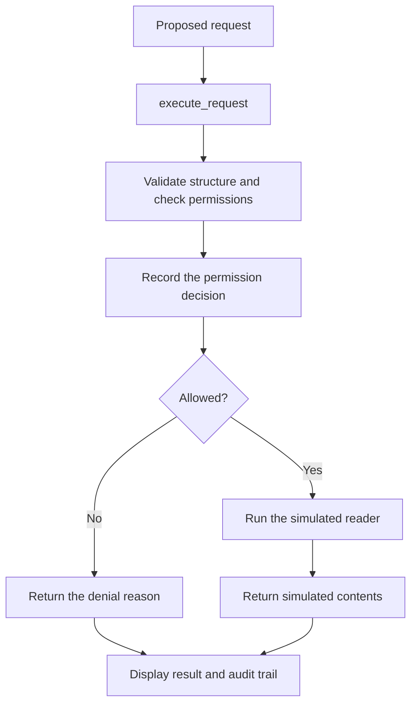

# AgentGuard

A Python learning project that checks an agent's proposed file operation before
letting it run, explains its decision, and records it in an audit trail.

The product direction is a security companion for Codex in VS Code: project
policies, review of uncertain actions, and records of skipped work. The current
implementation is a Python prototype plus a separately configured experimental
Codex hook. One shell-call interception has been verified in a disposable local
VS Code project; there is no AgentGuard VS Code extension yet. See the
[product vision and release criteria](docs/product_vision.md).

An intentional-crash experiment also showed that a command can run after the
hook fails. This hook-based prototype does not currently provide fail-closed
enforcement; the [proof record](docs/interception_proof.md) documents both outcomes.

The demo uses simulated requests and pretend file contents. You can explore the
permission flow without an AI account, API key, or real file access.

## Quick start

Clone or download this repository, then open a terminal in its root directory
(the folder containing this README).

Python is required. Development and verification used **Python 3.14.3**; other
versions have not been verified. The offline demo uses the Python standard library
and needs no dependencies or environment variables. Optional sign-in verification
uses PyJWT with its cryptography extra; see the authentication setup below.

Run the demo:

```powershell
python -m agent_guard.simulate
```

Run the tests:

```powershell
python -m unittest -v
```

Run both commands from the repository root. `-m` runs a module within its package,
so imports between the application modules resolve correctly.

## What the demo shows

The guard uses default deny: only reading `notes.txt` is permitted.
`notes.txt` and `secrets.txt` are example names; neither file needs to exist.

| Proposed request | Result |
| --- | --- |
| Read `notes.txt` | Execute the simulated reader and return its contents |
| Write `notes.txt` | Deny the action |
| Read `secrets.txt` | Deny the file |
| `None` | Deny the malformed request |

The demo prints:

```text
Simulated requests only; no files will be accessed.

EXECUTED: {'action': 'read', 'path': 'notes.txt'}
  Simulated contents of notes.txt
DENIED: {'action': 'write', 'path': 'notes.txt'}
  Action is not permitted.
DENIED: {'action': 'read', 'path': 'secrets.txt'}
  File is not permitted.
DENIED: None
  Malformed request.

Audit trail:
  {'action': 'read', 'path': 'notes.txt', 'allowed': True, 'reason': 'Reading notes.txt is permitted.'}
  {'action': 'write', 'path': 'notes.txt', 'allowed': False, 'reason': 'Action is not permitted.'}
  {'action': 'read', 'path': 'secrets.txt', 'allowed': False, 'reason': 'File is not permitted.'}
  {'action': None, 'path': None, 'allowed': False, 'reason': 'Malformed request.'}
```

## How it works

An agent proposes an action; the guard applies rules written in Python. This
prototype supplies example requests directly, so the permission and execution
behaviour can be examined independently of a model.



1. **Validate:** the request must be a dictionary containing string `action` and
   `path` values. A well-formed request can still be forbidden.
2. **Decide:** check structure first, action second, and path third. The first
   failed check determines the denial reason. Matching is exact and case sensitive.
3. **Record:** append one permission record before executing anything. Missing or
   non-string action/path fields become `None`; valid fields are kept independently.
   Extra request fields and file contents are omitted from records.
4. **Execute:** only permitted requests reach the reader. Denied requests return
   their reason without calling it.

`check_request()` returns `(allowed, reason)`. `execute_request()` returns
`(True, contents)` on success or `(False, reason)` on denial. `is_allowed()` is a
boolean-only wrapper around `check_request()`.

## Code map

| File or directory | Responsibility |
| --- | --- |
| [AGENTS.md](AGENTS.md) | Working agreements for coding assistants and pair programming |
| [agent_guard/guard.py](agent_guard/guard.py) | Request validation, permission decisions, and reasons |
| [agent_guard/executor.py](agent_guard/executor.py) | Guarded entry point and simulated reader |
| [agent_guard/audit.py](agent_guard/audit.py) | In-memory permission records |
| [agent_guard/simulate.py](agent_guard/simulate.py) | Four-request demo and displayed output |
| [agent_guard/model_requests.py](agent_guard/model_requests.py) | Decode model proposals as JSON before guard checks |
| [agent_guard/agent.py](agent_guard/agent.py) | Connect completed model text to guarded execution |
| [agent_guard/hook_probe.py](agent_guard/hook_probe.py) | Experimental scoped hook responder; one live shell-call denial verified |
| [agent_guard/model_client.py](agent_guard/model_client.py) | Account model discovery and completed streaming responses |
| [agent_guard/live_demo.py](agent_guard/live_demo.py) | Optional live model proposal and simulated execution demo |
| [agent_guard/oauth.py](agent_guard/oauth.py) | Sign-in URL preparation, PKCE, and callback-state checks |
| [agent_guard/oauth_callback.py](agent_guard/oauth_callback.py) | One-use loopback callback listener |
| [agent_guard/local_state.py](agent_guard/local_state.py) | Create, validate, and reuse the non-secret installation host ID |
| [agent_guard/auth_tokens.py](agent_guard/auth_tokens.py) | Optional token exchange and signed identity verification |
| [agent_guard/sign_in.py](agent_guard/sign_in.py) | Browser sign-in controller and account-verification command |
| [tests/](tests/) | Unit tests and integration tests |
| [docs/](docs/) | Learning walkthrough, personal log, and flexible finish plan |

Start with the loop in `simulate.py`, follow its call to `execute_request()`, then
read the guard and audit helpers. Inside the package, `.guard` in an import means
"the sibling guard module"; tests use full names such as `agent_guard.guard`.

## Tests

The tests cover allowed and forbidden requests,
malformed input, denial-reason priority, and the boolean wrapper. Mock readers
verify that permitted requests execute once and denied requests never execute.
Audit tests check record fields, snapshots, order, and logging before execution.
Integration tests exercise the demo and verify a fresh log on repeated runs.

Six model-response tests verify JSON decoding and denial of malformed or
forbidden proposals through the guarded executor. All tests are offline; they
do not call a model or authenticate an account. See the
[model connection notes](docs/model_connection.md).

OAuth tests cover sign-in URL preparation, fresh temporary values, PKCE,
and callback-state validation. Callback-listener tests send fake responses
over local loopback HTTP, checking validation, cancellation, one-time use,
deadlines, and suppressed request logs. No tests launch a browser or call OpenAI.

In the authentication virtual environment, **all 154 tests pass**, with none
skipped. The completed hook response builder, disposable fixture, and
installed-version observations are in the [interception investigation](docs/interception_proof.md).
The control marker write succeeded. After trusting the project hook, the blocked
command produced one matching denial receipt and no target file. This verifies
one shell call at that disposable workspace root. The completed reader-error handler is described in the
[walkthrough](docs/walkthrough.md#seventh-exercise-completed-operation-failure).
The additional native-boundary checks validate evidence classification, Windows
text newlines, and a dummy writer offline. A separate manual comparison verified
direct and writable-sandbox writes while the requested read-only sandbox denied
its write. That CLI result is not yet integrated into the VS Code guard workflow.
An isolated policy-combination helper gives deny priority over review and allow,
and requires review for empty input. Its five tests pass; it is not yet connected
to the executor or a configurable policy. See the
[completed exercise](docs/walkthrough.md#eighth-exercise-completed-combine-policy-decisions).
The completed pipeline tests verify allowed, forbidden, malformed,
and structurally invalid proposals. Eight signed-token tests are skipped if the optional
authentication dependency is absent. The signed-token tests use locally generated
keys and fake responses; they do not contact OpenAI. Host-ID tests verify creation,
reuse, and rejection of invalid saved data without overwriting it. Filesystem fixtures
live temporarily under the ignored
`.agent_guard/test-tmp/` directory and are removed after each test.

Run an individual area when working on it:

```powershell
python -m unittest tests.test_guard -v
python -m unittest tests.test_executor -v
python -m unittest tests.test_audit -v
python -m unittest tests.test_simulate -v
python -m unittest tests.test_model_requests -v
python -m unittest tests.test_oauth -v
python -m unittest tests.test_oauth_callback -v
python -m unittest tests.test_local_state -v
```

## Optional authentication setup and sign-in check

On Windows/PowerShell, run these commands from the repository root to create and
activate a virtual environment, install the optional authentication dependency,
and run the full test suite:

```powershell
python -m venv venv
.\venv\Scripts\Activate.ps1
python -m pip install -r requirements-auth.txt
python -m unittest -v
```

`has_plan_scope()` in `agent_guard/oauth.py` rejects non-string input, splits the
scope string into individual names, and checks for the complete name
`chatgpt.tokens.use.direct`. A substring is not enough.

```powershell
python -m unittest tests.test_oauth.PlanScopeTests -v
```

To try a live sign-in, run this command and complete Continue with ChatGPT in
your browser:

```powershell
python -m agent_guard.sign_in
```

The check reports verified identity and whether the required plan permission was
granted. It makes no model request and does not verify remaining allowance or
inference eligibility. It exits after the check, discarding in-memory tokens;
later processes sign in again using the saved client registration.

Exit status 0 means identity and permission were verified; 2 means identity was
verified without the plan permission; 1 means failure; 130 means cancellation
with Ctrl+C. Only non-token registration metadata is saved. A manual sign-in
check succeeded on 26 October 2026, as reported by the learner: identity and
plan-usage permission were verified. A separate live model demo also succeeded
that day, with a guarded simulated read and one audit record. Automated tests
continue to use fake responses.

## Current scope

This is an educational prototype with one hard-coded permission rule and an
optional real model connection. Agent-requested file operations remain simulated;
installation and registration metadata use local filesystem storage. Requested
paths are compared as strings; real path resolution and filesystem isolation
are outside this version.

The learner reported a successful live run on 26 October 2026 using GPT-6.1-Sol
(`gpt-6.1-sol`). The model proposed `{"action":"read","path":"notes.txt"}`;
the guarded executor returned simulated contents and recorded one allowed
permission decision. The learner wrote the parser-to-executor connection.
The learner also verified `Read secrets.txt`: the model preserved the forbidden
path, the guard returned `File is not permitted.`, and one denied audit record
was displayed without running the simulated reader.
The live `Write notes.txt` check also succeeded: the model preserved `write`,
the guard returned `Action is not permitted.`, and one denied audit record appeared.
The adapter handles the observed missing content-type header and empty terminal
output list by validating and retaining finalized stream events until successful
completion. Details and diagnostic history are in the connection notes.
With the authentication environment activated, try:

```powershell
python -m agent_guard.live_demo "Read notes.txt"
```

This opens browser sign-in and sends the instruction to a model using ChatGPT
plan usage. The command waits for a completed proposal, applies the Python guard,
and displays the result and audit trail. See the [connection notes](docs/model_connection.md#completed-exercise-connect-completed-text-to-the-guard).

Checks apply to requests sent through `execute_request()`. These are ordinary
Python functions, not an operating-system sandbox; code in the same process can
call the reader directly or modify the shared audit list.

Audit records describe **permission**, not completion. The executor translates
reader `OSError` into `OperationError` with a fixed safe message. Both demos
display it as `FAILED` with the original allowed audit record; they do not retry
the operation. Other unexpected errors propagate to the caller. Successful and
denied return tuples are unchanged. Records live only
in memory, are lost when the process ends, and are cleared when the demo starts.

Local `.env` files and `.agent_guard/` state are ignored by Git. The sign-in
controller keeps temporary values and tokens in memory; only the host ID, issued
client ID, and verified subject are persisted as registration metadata. A pending
client ID can be retained before exchange with a null subject; it is not a login.
Tokens are not persisted. A `.env` file is plaintext, not encrypted storage.
See the [storage plan](docs/model_connection.md#local-state-and-secrets).

## Learning and next steps

This project was built through pair programming, with implementation exercises
and tests added in small steps. The completed exercises are preserved in the
[learning walkthrough](docs/walkthrough.md). The dated
[learning log](docs/learning_log.txt) records progress, challenges, and where help
was used.

The [flexible finish plan](docs/finish_plan.md) records proposed next steps.
The optional real model connection has completed its first live run through the
existing guard, while file operations remain simulated. The selected route is
supported Sign in with ChatGPT plan usage. Model discovery and streaming handling
have offline tests; the learner's completed pipeline connects proposals to the
guard. Live allowed-path, forbidden-path, and forbidden-action checks have
succeeded. The connection fixes are committed and pushed; the latest documentation
records the final live action-denial check.
The completed operation-failure exercise also separates permission from execution
success, with fake-error tests covering the failure path. The offline demo remains
available. Details and
the first parsing exercise are in the [connection notes](docs/model_connection.md).
The [product vision](docs/product_vision.md) guides the next phase. A narrow
pre-execution interception proof has succeeded in the local VS Code workflow.
The crash test demonstrated fail-open behaviour for one case: the hook ran and
crashed, but the command still executed. An independently enforced boundary and
further coverage testing are needed before relying on this design for protection.
Saturday is a proof-of-concept
milestone. Each feature's expected behaviour will be discussed before implementation.
