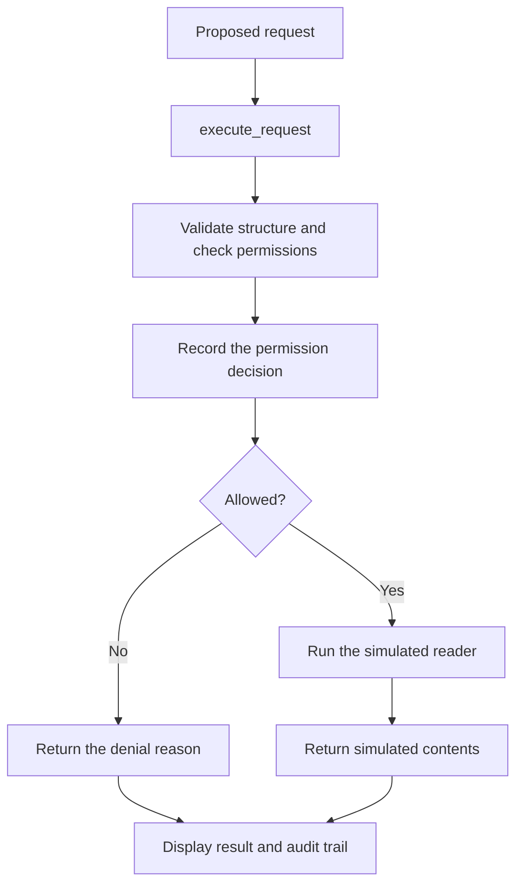

# Agent guard

A Python learning project that checks an agent's proposed file operation before
letting it run, explains its decision, and records it in an audit trail.

The demo uses simulated requests and pretend file contents. You can explore the
permission flow without an AI account, API key, or real file access.

## Quick start

Clone or download this repository, then open a terminal in its root directory
(the folder containing this README).

Python is required. Development and verification used **Python 3.14.3**; other
versions have not been verified. Everything uses the Python standard library,
so there are no dependencies to install and no environment variables to set.
A virtual environment is optional.

Run the demo:

```powershell
python -m agent_guard.simulate
```

Run the tests:

```powershell
python -m unittest -v
```

Run both commands from the repository root. `-m` runs a module within its package,
so imports between the application modules resolve correctly.

## What the demo shows

The guard uses default deny: only reading `notes.txt` is permitted.
`notes.txt` and `secrets.txt` are example names; neither file needs to exist.

| Proposed request | Result |
| --- | --- |
| Read `notes.txt` | Execute the simulated reader and return its contents |
| Write `notes.txt` | Deny the action |
| Read `secrets.txt` | Deny the file |
| `None` | Deny the malformed request |

The demo prints:

```text
Simulated requests only; no files will be accessed.

EXECUTED: {'action': 'read', 'path': 'notes.txt'}
  Simulated contents of notes.txt
DENIED: {'action': 'write', 'path': 'notes.txt'}
  Action is not permitted.
DENIED: {'action': 'read', 'path': 'secrets.txt'}
  File is not permitted.
DENIED: None
  Malformed request.

Audit trail:
  {'action': 'read', 'path': 'notes.txt', 'allowed': True, 'reason': 'Reading notes.txt is permitted.'}
  {'action': 'write', 'path': 'notes.txt', 'allowed': False, 'reason': 'Action is not permitted.'}
  {'action': 'read', 'path': 'secrets.txt', 'allowed': False, 'reason': 'File is not permitted.'}
  {'action': None, 'path': None, 'allowed': False, 'reason': 'Malformed request.'}
```

## How it works

An agent proposes an action; the guard applies rules written in Python. This
prototype supplies example requests directly, so the permission and execution
behaviour can be examined independently of a model.



1. **Validate:** the request must be a dictionary containing string `action` and
   `path` values. A well-formed request can still be forbidden.
2. **Decide:** check structure first, action second, and path third. The first
   failed check determines the denial reason. Matching is exact and case sensitive.
3. **Record:** append one permission record before executing anything. Missing or
   non-string action/path fields become `None`; valid fields are kept independently.
   Extra request fields and file contents are omitted from records.
4. **Execute:** only permitted requests reach the reader. Denied requests return
   their reason without calling it.

`check_request()` returns `(allowed, reason)`. `execute_request()` returns
`(True, contents)` on success or `(False, reason)` on denial. `is_allowed()` is a
boolean-only wrapper around `check_request()`.

## Code map

| File or directory | Responsibility |
| --- | --- |
| [AGENTS.md](AGENTS.md) | Working agreements for coding assistants and pair programming |
| [agent_guard/guard.py](agent_guard/guard.py) | Request validation, permission decisions, and reasons |
| [agent_guard/executor.py](agent_guard/executor.py) | Guarded entry point and simulated reader |
| [agent_guard/audit.py](agent_guard/audit.py) | In-memory permission records |
| [agent_guard/simulate.py](agent_guard/simulate.py) | Four-request demo and displayed output |
| [agent_guard/model_requests.py](agent_guard/model_requests.py) | Decode model proposals as JSON before guard checks |
| [agent_guard/oauth.py](agent_guard/oauth.py) | In-progress sign-in preparation and callback-state exercise |
| [tests/](tests/) | Unit tests and integration tests |
| [docs/](docs/) | Learning walkthrough, personal log, and flexible finish plan |

Start with the loop in `simulate.py`, follow its call to `execute_request()`, then
read the guard and audit helpers. Inside the package, `.guard` in an import means
"the sibling guard module"; tests use full names such as `agent_guard.guard`.

## Tests

All **41 tests pass**, covering allowed and forbidden requests,
malformed input, denial-reason priority, and the boolean wrapper. Mock readers
verify that permitted requests execute once and denied requests never execute.
Audit tests check record fields, snapshots, order, and logging before execution.
Integration tests exercise the demo and verify a fresh log on repeated runs.

Six model-response tests verify JSON decoding and denial of malformed or
forbidden proposals through the guarded executor. All tests are offline; they
do not call a model or authenticate an account. See the
[model connection notes](docs/model_connection.md).

Nine OAuth tests cover sign-in URL preparation, fresh temporary values, PKCE,
and callback-state validation. All forty-one tests pass with none skipped.
The sign-in helpers do not launch a browser or make network requests yet.

Run an individual area when working on it:

```powershell
python -m unittest tests.test_guard -v
python -m unittest tests.test_executor -v
python -m unittest tests.test_audit -v
python -m unittest tests.test_simulate -v
python -m unittest tests.test_model_requests -v
python -m unittest tests.test_oauth -v
```

## Current scope

This is an educational prototype with one hard-coded permission rule, no AI
model connection, and no real filesystem operations. Paths are compared as
strings; real path resolution and filesystem isolation are outside this version.

Checks apply to requests sent through `execute_request()`. These are ordinary
Python functions, not an operating-system sandbox; code in the same process can
call the reader directly or modify the shared audit list.

Audit records describe **permission**, not completion. Reader exceptions currently
propagate to the caller. Records live only in memory, are lost when the process
ends, and are cleared when the demo starts.

Local `.env` files and `.agent_guard/` state are ignored by Git. The planned
sign-in flow keeps temporary values and tokens in memory; no credentials are
currently collected or saved. A `.env` file is plaintext, not encrypted storage.
See the [storage plan](docs/model_connection.md#local-state-and-secrets).

## Learning and next steps

This project was built through pair programming, with implementation exercises
and tests added in small steps. The completed exercises are preserved in the
[learning walkthrough](docs/walkthrough.md). The dated
[learning log](docs/learning_log.txt) records progress, challenges, and where help
was used.

The [flexible finish plan](docs/finish_plan.md) records proposed next steps.
The next milestone is an optional real model connection that proposes requests
for the existing guard, while file operations remain simulated. The selected
route is supported Sign in with ChatGPT plan usage; implementation and live
eligibility checks are pending. The current demo remains offline. Details and
the first parsing exercise are in the [connection notes](docs/model_connection.md).
Configurable permissions are deferred. Each feature's expected behaviour will
be discussed before implementation.
